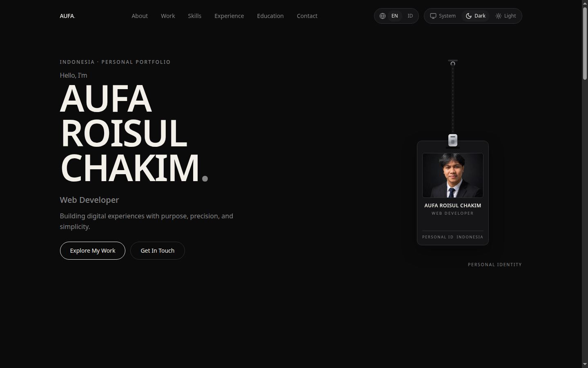
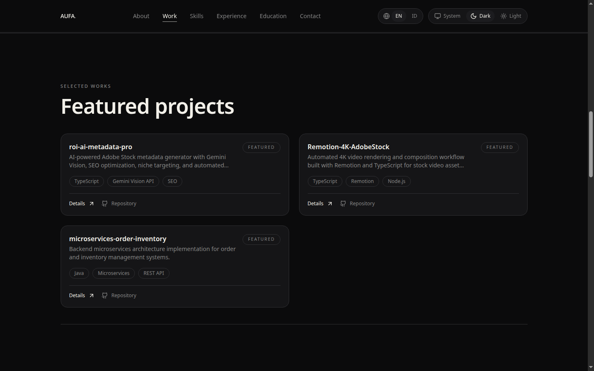
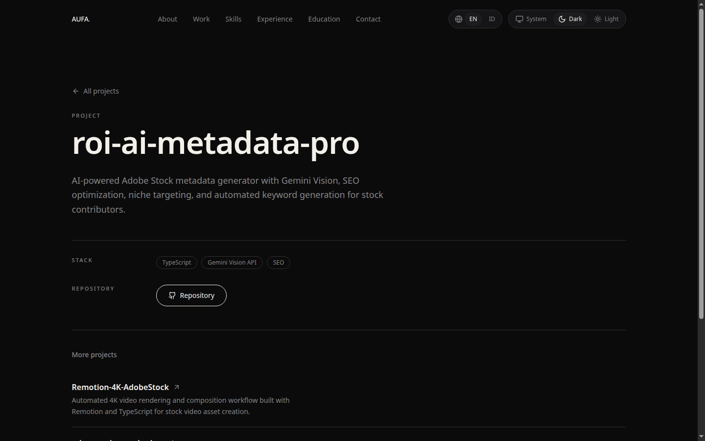
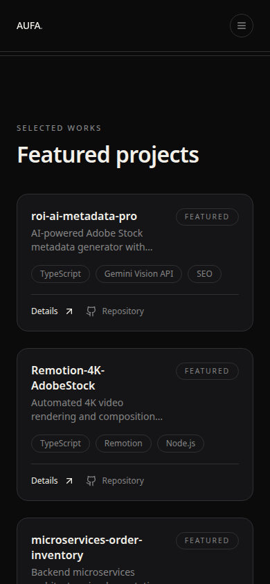

# Aufa Portfolio — Web Next.js

Portfolio pribadi versi Next.js: Dark Luxury × Minimal Editorial. Lanyard identitas yang bisa diseret, animasi scroll GSAP, halaman detail project, serta toggle bahasa Indonesia/Inggris dan tema gelap/terang.

## Tampilan









## Teknologi

- Next.js 16 (App Router), TypeScript, Tailwind CSS 4
- Motion dan GSAP + ScrollTrigger
- next-themes untuk tema gelap/terang

## Menjalankan

```bash
npm install
npm run dev
```

Buka http://localhost:3000. Build produksi:

```bash
npm run build
```

## Isi

- Hero dengan lanyard yang bisa diseret (dukungan keyboard, reduced motion)
- Selected Works — 3 project dengan halaman detail (`/projects/[slug]`)
- Skills, Experience (magang Dinas Kearsipan dan Perpustakaan Kab. Semarang), Education, Contact
- Data asli dari GitHub, tanpa metrik atau testimoni karangan

## Kontak

- Email: roischakim86@gmail.com
- Instagram: [@rois_chakim](https://instagram.com/rois_chakim)
- GitHub: [RoisChakim](https://github.com/RoisChakim)

© 2026 Aufa Roisul Chakim
